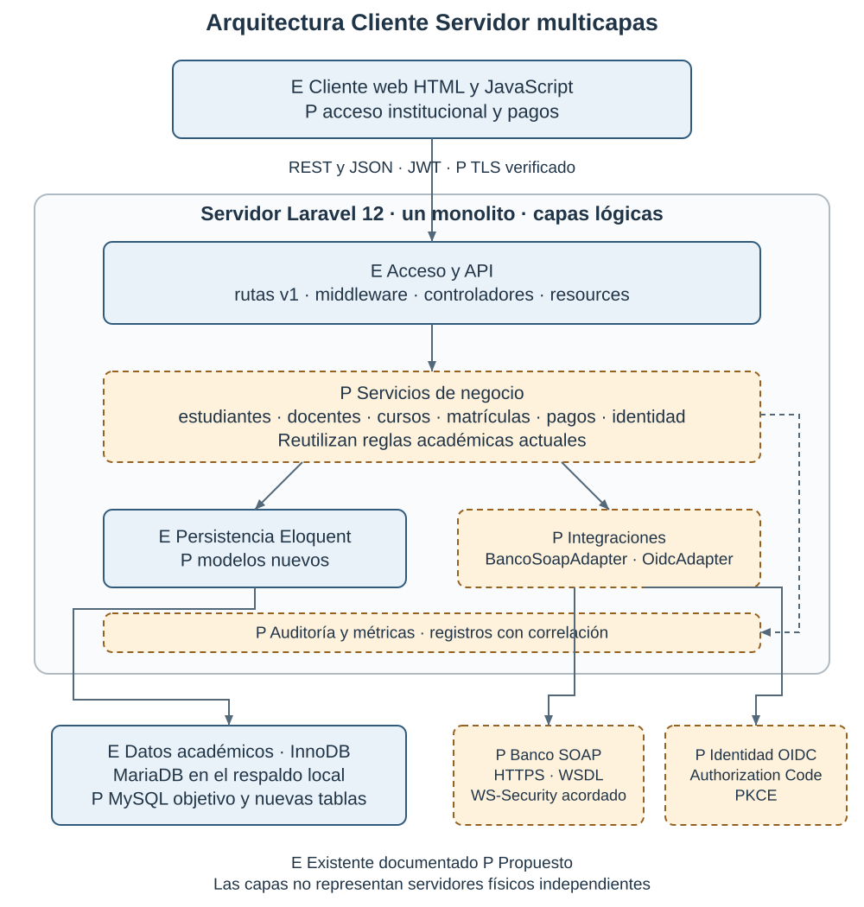
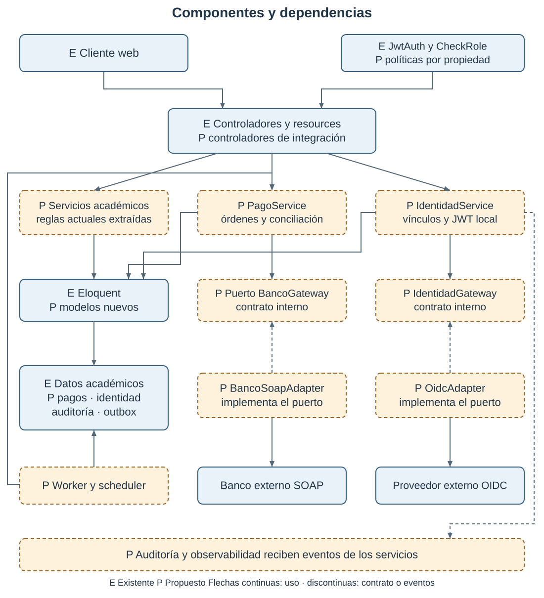
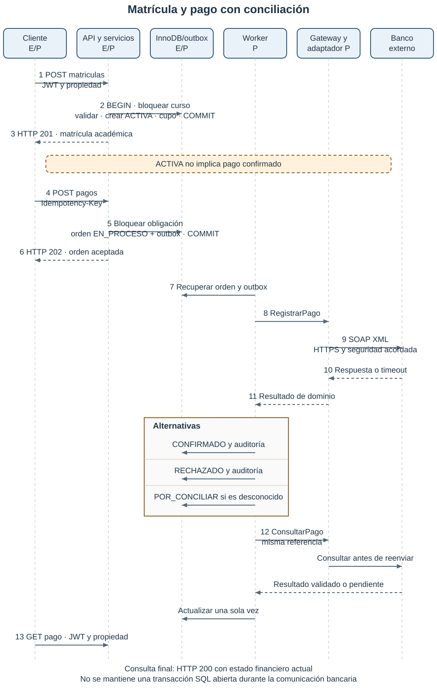

# Proyecto integrador de arquitectura de software para la gestión universitaria de cursos matrículas y pagos

Yenifer Bogotá Tapiero, Luna Sofia Ospina Rodriguez y Sara Sofia Rodriguez Hernández

Facultad de Ingeniería, Programa de Ingeniería de Sistemas, Universidad del Tolima, IDEAD

CAT Ibagué

Arquitectura de Software, Semestre VI - Grupo 04

Germán Eduardo Flores Santos

24 de octubre de 2026

Actualización del documento: 13 de noviembre de 2026

## Diagnóstico del Taller 4

El Taller 4 proporciona una base funcional para ampliar la plataforma universitaria sin reemplazar Laravel ni la API REST. La evolución seleccionada conserva la arquitectura Cliente/Servidor y organiza el monolito en capas y módulos de negocio. Pagos, identidad federada y operación bajo demanda elevada requieren nuevos componentes y validaciones.

Se revisaron las doce páginas del PDF, incluidas tablas, ejemplos JSON, capturas de Postman y vistas del cliente web. Las páginas indicadas corresponden a su posición física, contando la portada. El documento termina con capturas de la interfaz; no contiene una sección independiente de conclusiones ni diagramas arquitectónicos. Se contrastaron las evidencias con rutas, controladores, middleware, resources, modelos, migraciones, interfaz, respaldo SQL y colección Postman del proyecto disponible.

En este informe, **existente** significa documentado con evidencia o presente en el código; no implica una nueva ejecución exitosa. **Parcial** indica una base aprovechable con brechas concretas. **Pendiente** señala componentes o validaciones sin evidencia de realización. Las pruebas del Taller son antecedentes documentados, no pruebas repetidas durante esta actualización. Los diseños nuevos se identifican como propuestos.

| Elemento del integrador | Evidencia encontrada en el PDF | Estado | Acción necesaria |
|---|---|---|---|
| Contexto, actores y alcance | P. 2 presenta administración de cursos y matrículas; pp. 7 y 11 describen tres roles. | Parcial | Incorporar necesidades de registro, tesorería, identidad y periodos de alta demanda. |
| Canvas del negocio | No aparece un Canvas en las doce páginas. | Pendiente | Relacionar usuarios, valor, recursos y sostenibilidad con la arquitectura. |
| Requisitos verificables | Pp. 2-4 describen recursos, operaciones y errores; no hay catálogo RF/RNF. | Parcial | Definir exactamente ocho RF y cinco RNF con criterios de aceptación. |
| Ciclo de vida | No se presenta selección ni planificación de iteraciones. | Pendiente | Proponer evolución iterativa e incremental con Scrum. |
| Cliente/Servidor y REST | P. 2 declara monolito Laravel, REST, JSON, stateless y versión v1. | Existente | Conservar estilo, recursos y compatibilidad del contrato. |
| Capas y componentes | P. 2 identifica rutas, controladores, modelos, resources y middleware. | Parcial | Extraer servicios de negocio y diseñar adaptadores y observabilidad. |
| Datos académicos | P. 2 incluye cuatro recursos y relaciones; p. 8 muestra la base gestion. | Existente | Mantener relaciones; ampliar persistencia para pagos, identidad y auditoría. |
| Contrato REST | P. 3 enumera 17 endpoints de negocio; pp. 5-6 muestran matrícula y curso. | Existente | Conservar los 17 y añadir contratos nuevos sin atribuirles pruebas. |
| JWT y RBAC | Pp. 7-8 muestran login, expiración de 900 segundos, roles y payload decodificado. | Existente | Mantener permisos; reforzar validación y enlazar identidad federada. |
| HTTPS | Pp. 2 y 7 lo establecen; capturas y ejecución de pp. 4-12 usan HTTP en 127.0.0.1. | Parcial | Configurar TLS y demostrarlo en un entorno de despliegue. |
| Pagos mediante SOAP | P. 6 plantea banco, adaptador, WSDL y WS-Security, sin implementación. | Parcial | Diseñar contrato, estados, idempotencia, errores y conciliación. |
| Proveedor externo de identidad | No se evidencia integración externa. | Pendiente | Diseñar OpenID Connect y vinculación segura de cuentas. |
| Cliente HTML y JavaScript | Pp. 11-12 muestran vistas de ADMIN, ESTUDIANTE y DOCENTE. | Existente | Extender interfaz con acceso institucional y estado de pagos. |
| Pruebas funcionales | Pp. 8-10 documentan 56 solicitudes; p. 9 muestra 56 aprobadas, 0 fallidas y 0 errores. | Existente | Conservar evidencia histórica y ampliar regresión en próximas iteraciones. |
| Concurrencia de cupos | Pp. 9-10 incluyen duplicidad y cupo agotado, en ejecución funcional. | Parcial | Completar pruebas simultáneas; revisar cancelación y modificación de cupos. |
| Disponibilidad y rendimiento | La p. 9 muestra una ejecución funcional y su promedio; no hay ensayo de carga. | Pendiente | Establecer objetivos y medirlos con carga reproducible. |
| Auditoría, monitoreo y despliegue escalado | No se presentan evidencias de operación de estos componentes. | Pendiente | Diseñar métricas, alertas, registros y despliegue gradual. |
| Diagramas y decisiones | No hay diagramas de arquitectura, componentes o secuencia ni tabla de decisiones. | Pendiente | Incorporar tres diagramas coherentes y registrar decisiones. |

### Precisiones técnicas y correcciones propuestas

**Alcance de las pruebas.** La colección disponible contiene 56 solicitudes, coherentes con el PDF. El README local menciona 47 y debe actualizarse. La captura de la p. 9 muestra un promedio de 580 ms en una ejecución funcional; ese valor no representa un percentil, un ensayo concurrente ni una garantía de rendimiento. Las afirmaciones de esta actualización se limitan a la evidencia histórica; no se ejecutó nuevamente el Runner.

**Cantidad de operaciones.** Los 17 endpoints de la p. 3 corresponden al negocio académico. El código incorpora además `POST /api/v1/auth/login`: son 18 combinaciones de método y ruta al incluir autenticación. Los endpoints nuevos no forman parte de esas 18 operaciones.

**Motor de datos.** El PDF denomina MySQL al almacenamiento. El encabezado de `gestion.sql` identifica MariaDB 10.4.32 y sus tablas usan InnoDB. Se preserva el modelo relacional y la conexión compatible con MySQL de Laravel; el despliegue propuesto toma MySQL 8.4 como motor objetivo. Migrar requiere verificar colaciones, índices, restricciones y consultas con datos de prueba. No se afirma que el proyecto ya ejecute MySQL 8.4.

**Contrato JSON.** Los ejemplos de pp. 5-6 muestran objetos de respuesta en la raíz. `AppServiceProvider` configura `JsonResource::withoutWrapping()`, coherente con esos ejemplos de recursos individuales. Las colecciones paginadas conservan su estructura de datos y metadatos de Laravel; no deben documentarse como un objeto individual. Se mantiene el contrato de objetos en la raíz para los cinco ejemplos seleccionados y se verificará su compatibilidad al ampliar v1.

**Seguridad documentada y demostrada.** HTTPS es una decisión apropiada del Taller, pero las capturas prueban HTTP local. La imagen titulada payload en la p. 7 corresponde a una respuesta del login; el payload decodificado aparece arriba de la p. 8. Conviene ajustar sus rótulos. Las credenciales ilustrativas visibles no se trasladan al nuevo documento ni a un despliegue real.

**Transacciones y concurrencia.** `MatriculaController::store` ya usa `DB::transaction` y `lockForUpdate` sobre el curso. Por tanto, no se propone esta protección como si fuera nueva. La cancelación verifica el estado antes de la transacción y no vuelve a bloquear la matrícula: dos solicitudes simultáneas podrían devolver dos veces el cupo. La actualización de `cupoMaximo` también necesita coordinarse con el mismo bloqueo. Son riesgos deducidos de inspección estática, no fallos reproducidos en esta revisión.

**Historial y semántica HTTP.** El borrado de estudiantes o cursos sin matrículas activas elimina sus matrículas canceladas en el código, aunque algunos comentarios lo atribuyen a cascadas de FK que no aparecen en las migraciones. Al incorporar pagos se propone una baja lógica, conservando la operación de eliminación para el usuario y su respuesta 204, con retención del historial y autorización explícita. Además, la creación de matrícula devuelve `Location` a una ruta de detalle no implementada; se propone añadir `GET /api/v1/matriculas/{id}` con control de propiedad. PUT permite omitir `estado` en el código, pese a describirse como reemplazo completo: se debe precisar su valor predeterminado o hacerlo obligatorio. No se inventan resultados de estas correcciones.

**SOAP y permisos.** La afirmación de la p. 6 sobre garantía conjunta mediante WS-AtomicTransaction y WS-ReliableMessaging necesita matizarse: requiere soporte, coordinación y acuerdos entre organizaciones; fiabilidad de entrega no equivale a atomicidad del pago. La vista docente de la p. 12 se denomina cursos asignados, pero `GET /cursos` y `GET /docentes/{id}/cursos` no restringen por docente en el código. Se conserva la consulta general del catálogo y se reserva la vista «Mis cursos» al filtro verificado del docente autenticado; las matrículas sí están filtradas por sus cursos.

## 1 Introducción contexto y alcance

La universidad necesita coordinar la información académica de estudiantes, docentes, cursos y matrículas, y relacionarla con el recaudo y el acceso institucional. Durante las matrículas, una consulta de cupos desactualizada o un pago cuyo resultado no se confirma puede producir reclamos, reprocesos y decisiones académicas incorrectas. El objetivo de la plataforma es ofrecer operaciones trazables, permisos definidos y consistencia del cupo, incluso cuando una entidad externa responde con demora.

El Taller 4 resolvió la administración académica mediante una aplicación Laravel 12, una base relacional y una interfaz HTML y JavaScript. Esta actualización mantiene ese activo: conserva estudiantes, docentes, cursos y matrículas, sus relaciones y los 17 endpoints de negocio. La evolución añade una separación explícita de responsabilidades y diseña pagos e identidad externa como módulos del mismo monolito. El navegador continúa siendo el cliente y Laravel el servidor; REST y JSON se mantienen en la comunicación con la interfaz.

Los estudiantes consultan la oferta y gestionan sus matrículas; los docentes consultan cursos y estudiantes según sus permisos; el ADMIN administra recursos y supervisa operaciones. Registro académico define reglas de matrícula y tesorería determina valores y conciliación. El área de TI administra disponibilidad, accesos y respaldo. El banco procesa el recaudo y el proveedor institucional de identidad autentica personas. Tesorería y TI son actores organizacionales; no se agregan roles técnicos distintos de ADMIN, DOCENTE y ESTUDIANTE sin una decisión posterior de privilegios mínimos.

El alcance implementado y documentado comprende la API académica, JWT local, RBAC e interfaz básica. El alcance diseñado incluye capas de negocio, contratos de pago e identidad, integración bancaria SOAP, seguridad ampliada y operación escalable. La implementación de estos componentes, el contrato real con el banco, el proveedor de identidad y las mediciones quedan pendientes. No se incluyen nómina, biblioteca, gestión curricular completa ni almacenamiento de datos de tarjetas. Los importes serán definidos por tesorería; el cliente no determina cuánto debe pagar.

El análisis del negocio se expresa en Canvas y requisitos; el ciclo de vida organiza incrementos verificables; los ejes de ingeniería se concretan en trazabilidad, gestión del cambio, calidad, construcción y operación. Las capas y componentes distribuyen responsabilidades, mientras REST, JSON y SOAP resuelven las interacciones internas y externas. Esta relación evita que el documento se limite a definiciones de la asignatura.

## 2 Canvas resumido del negocio

| Elemento | Aplicación al caso universitario |
|---|---|
| Segmentos de usuarios | Estudiantes, docentes, registro académico, tesorería y TI. Se representan técnicamente mediante los tres roles existentes y permisos por recurso. |
| Propuesta de valor | Matrícula con cupos consistentes, consulta de oferta, seguimiento del pago y acceso institucional; menos desplazamientos y reprocesos. |
| Canales | Cliente web HTML y JavaScript sobre HTTPS; API v1 como canal de integración autorizado; soporte institucional para incidencias. |
| Relación con usuarios | Autoservicio con mensajes de estado y errores comprensibles; acompañamiento de registro académico y tesorería ante conflictos. |
| Actividades clave | Mantener oferta y estudiantes, asignar docentes, matricular y cancelar, liquidar y conciliar pagos, gestionar identidad y operar el servicio. |
| Recursos clave | Código Laravel, modelo relacional, información académica, personal funcional y técnico, certificados TLS y contratos externos. |
| Socios clave | Banco recaudador, proveedor de identidad institucional, dependencias académicas y proveedor de infraestructura. |
| Estructura de costos | Alojamiento, base de datos, respaldos, operación y soporte, certificados cuando apliquen, integración y comisiones bancarias pactadas. No se estiman valores sin cotizaciones. |
| Financiación y sostenibilidad | Presupuesto institucional y mantenimiento programado; el recaudo académico se registra como proceso de la universidad, sin asumir que constituye un ingreso propio del software. |

La propuesta de valor exige consistencia y trazabilidad antes de añadir infraestructura. Los socios externos justifican adaptadores con contratos claros. El presupuesto y el tamaño del equipo favorecen conservar un monolito modular y escalarlo por etapas. Los canales justifican mantener REST y JSON en el cliente y reservar SOAP al banco que lo requiera.

## 3 Requisitos funcionales y no funcionales

Las prioridades indican orden de implementación, no autorización para retirar funciones existentes. Los siguientes criterios son verificaciones que deberán realizarse; no se presentan como resultados obtenidos. Los valores de carga, tiempos y disponibilidad son objetivos de diseño sujetos a validación con infraestructura y volumen de datos acordados.

### 3.1 Ocho requisitos funcionales

| Código | Descripción y base | Prioridad | Criterio de aceptación verificable |
|---|---|---|---|
| RF-01 | Gestionar estudiantes: registrar, listar, buscar, consultar y dar de baja conforme al contrato existente. | Alta | ADMIN registra datos válidos y obtiene 201; documento o correo duplicado produce 422. Un estudiante consulta únicamente su perfil; otra identidad recibe 403. La baja con matrícula activa produce 409 y la baja autorizada conserva el historial en el diseño ampliado. |
| RF-02 | Gestionar docentes y su asignación a cursos, conservando altas, consultas y bajas existentes. | Alta | ADMIN crea un docente con 201; un correo duplicado produce 422; eliminar uno con cursos asignados produce 409. La consulta de cursos de un docente retorna la relación correspondiente. |
| RF-03 | Consultar y administrar cursos por periodo, docente y estado, con paginación y actualización completa o parcial. | Alta | Los tres roles consultan cursos con 200; ADMIN crea con 201 y actualiza con 200. Se rechazan créditos fuera de 1 a 10 y un cupo máximo inferior a los cupos ocupados. Un estudiante no puede crear cursos: 403. |
| RF-04 | Crear y consultar matrículas del periodo, respetando identidad, oferta, cupo y alcance por rol. | Crítica | Con un curso abierto y cupo disponible, la creación retorna 201 y descuenta exactamente un cupo. Duplicidad activa o cupo agotado produce 409; periodo diferente produce 422. En dos solicitudes simultáneas por el último cupo solo una crea matrícula. ESTUDIANTE ve las suyas y DOCENTE las de sus cursos. |
| RF-05 | Cancelar matrículas propias o administradas y liberar el cupo una sola vez, conservando trazabilidad. | Crítica | ESTUDIANTE propietario o ADMIN cancela con 204; DOCENTE recibe 403. Dos cancelaciones concurrentes generan una sola liberación y la segunda obtiene 409. Si hay pago confirmado, se registra una solicitud de revisión de devolución sin afirmar que el banco ya reembolsó. |
| RF-06 | Registrar y procesar pagos asociados a matrículas mediante el adaptador bancario, con idempotencia y consulta de estado. Propuesto. | Crítica | Una orden autorizada con clave de idempotencia retorna 202; repetir la misma clave y contenido devuelve la misma orden, sin otro cobro. Un resultado desconocido permanece POR_CONCILIAR; solo la confirmación verificable del banco permite marcar CONFIRMADO. |
| RF-07 | Autenticar usuarios con JWT local y añadir acceso mediante identidad institucional OpenID Connect. Integración propuesta. | Alta | Login local válido retorna 200. En el flujo externo, código válido, PKCE y estado de un solo uso permiten emitir JWT local para la cuenta vinculada. Estado incorrecto, código reutilizado o token externo inválido impiden el acceso. Un identificador externo sin vínculo autorizado no crea ADMIN. |
| RF-08 | Aplicar permisos por rol y propiedad, y registrar auditoría de operaciones académicas y financieras. Base RBAC existente; auditoría ampliada propuesta. | Crítica | Pruebas de acceso directo a la API devuelven 401 sin token y 403 sin permiso. Cada alta, cambio, cancelación y transición de pago genera un evento con actor, recurso, resultado, fecha e identificador de correlación, sin contraseñas ni tokens. |

### 3.2 Cinco requisitos no funcionales

| Código | Descripción | Prioridad | Criterio de aceptación verificable y objetivo |
|---|---|---|---|
| RNF-01 | Seguridad del transporte, identidad, autorización y entradas. | Crítica | En preproducción, el 100 % de rutas de negocio exige JWT válido y permiso aplicable; certificados TLS válidos en todos los accesos externos; expiración local objetivo de 900 s. Una matriz negativa incluye acceso ajeno, expiración, rol, firma y validaciones. Ningún secreto aparece en logs ni errores de prueba. |
| RNF-02 | Disponibilidad y recuperación de las operaciones académicas. | Alta | Objetivo mensual de 99,5 %, calculado con sondeos externos cada minuto; se informa la ventana y las interrupciones, incluidos mantenimientos. En un mes de 30 días equivale a hasta 216 minutos no disponibles. Ensayo de restauración con RPO ≤ 15 min y RTO ≤ 60 min. No hay medición actual que demuestre estos valores. |
| RNF-03 | Rendimiento bajo una carga académica definida. | Alta | En preproducción con 10 000 estudiantes, 500 cursos y 50 000 matrículas, sostener 100 usuarios virtuales durante 15 min; mezcla 80 % consultas y 20 % escrituras. Objetivos p95 ≤ 800 ms para consultas, ≤ 1 500 ms para matrícula y < 1 % de errores 5xx. Se miden por operación; los 409 de negocio se reportan aparte. La latencia bancaria se mide separadamente y no se oculta. |
| RNF-04 | Mantenibilidad y trazabilidad de cambios. | Alta | Todo cambio de reglas identifica RF/RNF y decisión relacionada; en revisión, controladores delegan reglas nuevas en servicios y ningún controlador usa SoapClient directamente. La regresión de 56 solicitudes académicas debe conservar sus resultados esperados sobre datos aislados. El 100 % de escenarios críticos acordados de cupo, permisos, cancelación y pagos tiene prueba automatizada. Es una meta de proceso, no cobertura ya alcanzada. |
| RNF-05 | Escalabilidad horizontal sin pérdida de consistencia. | Alta | En el mismo conjunto de datos y mezcla de RNF-03, comparar una y dos instancias equivalentes de Laravel sobre almacenamiento compartido. Objetivo: al menos 1,5 veces el caudal sostenible con dos instancias, manteniendo límites p95 y errores. Una ráfaga de 100 solicitudes por 10 cupos admite exactamente 10 matrículas distintas; no hay cupos negativos ni cobros duplicados en reintentos. |

El cumplimiento de RNF-02 requiere respaldos y recuperación además de balanceo. RNF-05 se acepta únicamente después de medir el posible cuello de botella de la base de datos. No se interpreta la presencia de JWT como evidencia suficiente de seguridad ni la ejecución secuencial de Postman como evidencia de escalabilidad.

## 4 Selección del ciclo de vida

Un ciclo secuencial facilita entregar documentación estable, pero retrasa la retroalimentación sobre los contratos del banco y del proveedor de identidad. El modelo en V relaciona etapas y pruebas con claridad; su disciplina de verificación resulta útil para pagos, aunque no obliga a ejecutar todo el proyecto en una sola secuencia. Un enfoque espiral prioriza riesgos e integración, pero su formalidad completa añade trabajo para el equipo académico.

Se selecciona un ciclo **iterativo e incremental con Scrum**, manteniendo una lista priorizada de producto y entregas pequeñas. La incertidumbre está en las integraciones y la operación, mientras la API académica ya ofrece una base demostrable. Cada incremento debe mantener las funciones del Taller y resolver un conjunto verificable de requisitos. Scrum no sustituye las decisiones técnicas ni la evidencia de pruebas (Schwaber y Sutherland, 2020).

| Iteración propuesta | Incremento y requisitos | Validación de salida |
|---|---|---|
| Sprint 1 de dos semanas | Establecer línea base, completar documentación de contrato JSON, extraer servicios académicos sin cambiar comportamiento y corregir cancelación concurrente. RF-01 a RF-05; RNF-04. | Regresión aislada de 56 solicitudes, revisión de contratos y pruebas simultáneas de matrícula, cancelación y cambio de cupo. |
| Sprint 2 de dos semanas | Enlace OIDC, persistencia de identidad externa, refuerzo JWT, controles por propiedad y auditoría. RF-07 y RF-08; RNF-01. | Proveedor de prueba, flujo PKCE, estados caducados, códigos repetidos y cuentas sin vínculo. Demostración por los tres roles. |
| Sprint 3 de dos semanas | Órdenes de pago, idempotencia, adaptador SOAP y conciliación. RF-06 y RF-08. | Banco simulado para aceptación, rechazo y timeout; verificación de reintentos sin duplicados. El sandbox real depende del convenio. |
| Sprint 4 de dos semanas | TLS, métricas, alertas, respaldos y despliegue de dos instancias cuando proceda. RNF-02, RNF-03 y RNF-05. | Pruebas de carga reproducibles, caída de una instancia y restauración de respaldo. Registro de resultados y limitaciones. |

Son ocho semanas de planificación tentativa, no un compromiso ya ejecutado. El Product Owner recoge prioridades de registro académico y tesorería; el Scrum Master facilita eventos y seguimiento de impedimentos; las integrantes construyen y validan incrementos. Los nombres no se asignan a responsabilidades nuevas sin acuerdo del equipo. Cada sprint contiene planificación, coordinación diaria, revisión y retrospectiva. La definición de terminado exige contrato actualizado, permisos, pruebas relevantes y ausencia de regresiones; una integración simulada se etiqueta como tal.

Los ejes de ingeniería se integran así: análisis y requisitos mediante Canvas y criterios; diseño mediante componentes y decisiones; construcción mediante servicios y adaptadores; calidad mediante pruebas; gestión mediante backlog y control de versiones; operación mediante recuperación y observabilidad. El resultado de una medición puede modificar el backlog, sin convertir una meta no alcanzada en una afirmación de cumplimiento.

## 5 Arquitectura Cliente Servidor multicapas

### 5.1 Responsabilidades y dependencias

La solución continúa siendo un monolito Laravel con módulos académicos, identidad y pagos. Las capas son divisiones lógicas del código; pueden ejecutarse en una misma instancia de la aplicación. Un servidor de base de datos separado o varias instancias del monolito pertenecen al despliegue físico, no constituyen una capa adicional de negocio.

| Capa | Base actual y evolución propuesta | Dependencias permitidas |
|---|---|---|
| Presentación | HTML y JavaScript existentes. Se añaden acceso institucional y estado financiero. Muestra errores sin decidir permisos ni cupos. | API v1 por HTTPS; no accede directamente a MySQL ni al banco. |
| Acceso y API | Rutas, JwtAuth, CheckRole, controladores, validación y resources existentes. Se añaden políticas por objeto y controladores de integración. | Servicios de aplicación; la autenticación resuelve usuario y contexto autorizado. |
| Lógica de negocio | Hoy varias reglas están en controladores. Se proponen EstudianteService, DocenteService, CursoService, MatriculaService, PagoService e IdentidadService. | Modelos/persistencia y puertos de integración; no conoce el DOM ni construye respuestas HTTP. |
| Persistencia | Eloquent y tablas actuales; nuevas tablas de pagos, identidad, auditoría y trabajos de integración. | Motor relacional y transacciones locales. Se preservan claves y relaciones existentes. |
| Integraciones externas | No implementadas en la evidencia. Se proponen BancoSoapAdapter y OidcAdapter. | Contratos del banco y del proveedor; implementan interfaces usadas por servicios. |

Las integraciones son una frontera lógica con adaptadores, no un servidor independiente obligatorio. El servicio de pago usa un puerto `BancoGateway` para que las pruebas puedan sustituir al proveedor. El adaptador implementa ese puerto y traduce XML, errores y estados. Se evita crear repositorios que solo dupliquen Eloquent: el ORM existente es suficiente mientras no aparezca una necesidad concreta.

El flujo académico es navegador, middleware de autenticación y autorización, controlador, servicio, modelo y base de datos; la respuesta vuelve mediante resource y JSON. La validación sintáctica se realiza en la entrada, mientras cupo, periodo y propiedad se verifican dentro del caso de uso y de su transacción cuando corresponda. La interfaz puede anticipar errores, pero el servidor conserva la decisión final.

### 5.2 Diagrama de arquitectura lógica



Figura 1. E identifica componentes existentes; P identifica componentes propuestos. En la lógica de negocio, la separación como servicios es propuesta aunque reutiliza reglas actuales. Las conexiones externas y el servicio de observabilidad no implican que ya estén desplegados. Código Mermaid disponible en `diagramas/arquitectura.mmd`.

### 5.3 Modelo de datos que se conserva y amplía

Se mantienen `docentes 1:N cursos`, `estudiantes 1:N matriculas` y `cursos 1:N matriculas`; la relación entre estudiantes y cursos sigue resuelta por matrícula y periodo. `users` vincula usuarios con estudiante o docente para aplicar propiedad. La matrícula académica conserva ACTIVA y CANCELADA: **ACTIVA no significa pago confirmado**. Esta separación mantiene el comportamiento existente y exige que cualquier proceso que necesite solvencia consulte el estado financiero. Una eventual regla de activación condicionada al pago necesitaría aprobación funcional y migración explícita, no un cambio silencioso en v1.

| Ampliación propuesta | Datos y restricciones principales |
|---|---|
| identidades_externas | user_id, issuer, subject, fechas; UNIQUE(issuer, subject). Evita usar el correo como identidad externa permanente. |
| obligaciones_pago | matricula_id, concepto, valor DECIMAL(12,2), moneda y estado; liquidación definida por tesorería. No se confía en el importe enviado por el cliente. |
| pagos | obligacion_id, actor_id, clave_idempotencia, hash_solicitud, referencia_universidad, referencia_banco, valor, moneda, estado y fechas. Unicidad de referencia y de clave por actor; referencia bancaria única cuando exista. |
| eventos_pago | pago_id, estado anterior/nuevo, fecha y referencia verificable; conserva decisiones y evidencia del proveedor sin secretos. |
| auditoria | actor, rol efectivo, acción, recurso, resultado, timestamp y correlation_id; acceso restringido y política de conservación institucional. |
| outbox_integracion | Evento pendiente persistido junto con la orden, reintentos y próxima ejecución. Permite recuperar trabajos aun si falla el envío a la cola. |

Una matrícula puede tener obligaciones definidas por tesorería; cada obligación admite intentos de pago históricos, pero no más de un cobro confirmado para la misma obligación. Un bloqueo sobre la obligación serializa la creación de órdenes: si existe una EN_PROCESO o POR_CONCILIAR, se devuelve su estado o un conflicto antes de generar otra. Se requiere además una restricción de unicidad para la confirmación y conciliación de duplicados externos. No se almacenan números de tarjeta ni credenciales bancarias del estudiante.

## 6 Identificación y categorización de componentes

| Componente y estado | Categoría | Responsabilidad | Tecnología | Interacciones |
|---|---|---|---|---|
| Cliente web E con ampliaciones P | Presentación | Consultar oferta, gestionar recursos según rol y mostrar matrícula y pago. | HTML y JavaScript | API mediante JSON y Bearer JWT. |
| Rutas v1 y controladores académicos E | Acceso/API | Enrutar, validar entradas y producir HTTP y JSON. | Laravel 12 y resources | Middleware y servicios propuestos; actualmente también modelos. |
| JwtAuth y CheckRole E; políticas P | Seguridad | Validar token, recuperar usuario y aplicar rol/propiedad. | firebase/php-jwt y Laravel | users, controladores e IdentidadService. |
| Servicios académicos P | Negocio | Aislar reglas existentes, transacciones de cupos y bajas. | Clases PHP en Laravel | Eloquent y auditoría. |
| PagoService P | Negocio financiero | Liquidación autorizada, idempotencia, estados y conciliación. | PHP y transacciones | Obligaciones, pagos, outbox y BancoGateway. |
| IdentidadService P | Negocio de identidad | Resolver vínculo institucional y emitir JWT local autorizado. | PHP y OIDC | OidcAdapter, users e identidades_externas. |
| Modelos y almacenamiento E con ampliaciones P | Persistencia | Relaciones, consultas y consistencia local. | Eloquent, InnoDB; MariaDB local y MySQL objetivo | Servicios y tablas académicas/financieras. |
| BancoSoapAdapter P | Integración | Consumir WSDL y traducir mensajes y fallos bancarios. | PHP SoapClient y soporte WS-Security acordado | PagoService, worker y banco. |
| OidcAdapter P | Integración | Intercambiar código y validar respuesta del proveedor. | HTTPS, OIDC, PKCE y JWKS | IdentidadService y proveedor institucional. |
| Worker, scheduler y outbox P | Procesamiento asíncrono | Entregar órdenes y consultar operaciones pendientes. | Colas y planificación Laravel | Persistencia, adaptador y auditoría. |
| Logs estructurados, auditoría y métricas P | Observabilidad | Correlacionar incidencias y medir errores, latencia y estados pendientes. | Logging Laravel, colector y monitor externo por seleccionar | API, workers y alertas de TI. |
| Proxy TLS y balanceador P | Infraestructura | Cifrar conexiones y repartir solicitudes hacia instancias saludables. | Nginx o servicio equivalente | Navegador, instancias Laravel y sondas. |

E significa existente y P propuesto. Laravel incluye infraestructura genérica de logs, colas y tablas auxiliares, pero eso no demuestra auditoría de negocio, workers operando o tableros de monitoreo. Los servicios propuestos reducen la dependencia entre controladores y reglas; los adaptadores concentran cambios externos. Una modificación del WSDL no debe obligar a modificar el controlador de matrículas.



Figura 2. Las flechas representan uso o intercambio; `BancoGateway` y `IdentidadGateway` son puertos propuestos. Los adaptadores dependen del contrato de esos puertos. Código en `diagramas/componentes.mmd`.

## 7 Servicios web REST y JSON

Se seleccionan exactamente cinco endpoints representativos: tres reutilizados del Taller y dos nuevos. El host público del PDF es una dirección ilustrativa, no un despliegue verificado. Se conserva `/api/v1`, camelCase en el contrato y snake_case en persistencia. Salvo el intercambio de identidad previo al login, se exige `Authorization: Bearer <JWT>`; las solicitudes con cuerpo emplean `Content-Type: application/json`.

Los ejemplos son ilustraciones de contrato, no nuevas respuestas capturadas. Los objetos existentes siguen la forma raíz del PDF y la configuración `withoutWrapping()` del proyecto. Los nuevos contratos propuestos conservan esa convención. Las consultas paginadas no seleccionadas en estos ejemplos mantienen datos y metadatos de paginación.

### 7.1 Registro de estudiantes existente

**Método y URI:** `POST /api/v1/estudiantes`. **Propósito:** registrar la ficha académica; no crea automáticamente una cuenta institucional. **Rol:** ADMIN. **Parámetros:** body con documento, nombres, apellidos, correo y programa; sin path ni query. **Éxito:** 201 Created y `Location: /api/v1/estudiantes/1021`. **Errores:** 401, 403 y 422 por formato o duplicidad. Los valores personales son ejemplos académicos.

Solicitud:

```json
{
  "documento": "1000123456",
  "nombres": "Ana",
  "apellidos": "Martínez",
  "correo": "ana.ejemplo@example.edu",
  "programa": "Ingeniería de Sistemas"
}
```

Respuesta de contrato:

```json
{
  "id": 1021,
  "documento": "1000123456",
  "nombres": "Ana",
  "apellidos": "Martínez",
  "correo": "ana.ejemplo@example.edu",
  "programa": "Ingeniería de Sistemas",
  "estado": "ACTIVO"
}
```

### 7.2 Consulta de curso existente

**Método y URI:** `GET /api/v1/cursos/{id}`. **Propósito:** consultar oferta y cupo al momento de la lectura. **Roles:** ADMIN, DOCENTE y ESTUDIANTE autenticados. **Parámetros:** path id entero; sin body ni query. **Éxito:** 200 OK. **Errores:** 401 y 404. Una lectura con 12 cupos no reserva un lugar; el cupo se confirma dentro de la transacción de matrícula.

Se reutiliza el ejemplo de las pp. 5-6 del Taller:

```json
{
  "id": 305,
  "codigo": "ARQ-301",
  "nombre": "Arquitectura de Software",
  "creditos": 3,
  "periodo": "2026-2",
  "cupoMaximo": 35,
  "cupoDisponible": 12,
  "estado": "ABIERTO",
  "docente": {"id": 14, "nombres": "Carlos", "apellidos": "Rojas"}
}
```

### 7.3 Creación de matrícula existente

**Método y URI:** `POST /api/v1/matriculas`. **Propósito:** matricular a un estudiante en un curso y periodo. **Roles:** ESTUDIANTE propietario o ADMIN; DOCENTE no autorizado. **Parámetros:** body estudianteId y cursoId enteros existentes, periodo con formato AAAA-1 o AAAA-2. **Éxito:** 201 Created; el Taller presenta `Location: /api/v1/matriculas/9001`. Esa URI requiere la consulta de detalle propuesta en el diagnóstico. **Errores:** 401, 403, 409 por duplicidad, cierre o cupo agotado, y 422 por validación.

Solicitud conservada de la p. 5:

```json
{"estudianteId": 1021, "cursoId": 305, "periodo": "2026-2"}
```

Respuesta conservada del ejemplo, incluida su fecha histórica:

```json
{
  "id": 9001,
  "estudiante": {"id": 1021, "nombres": "Ana", "apellidos": "Martínez"},
  "curso": {
    "id": 305,
    "codigo": "ARQ-301",
    "nombre": "Arquitectura de Software",
    "creditos": 3
  },
  "periodo": "2026-2",
  "estado": "ACTIVA",
  "fechaMatricula": "2026-10-24T17:43:04+00:00"
}
```

El nuevo módulo vinculará una obligación de pago sin presentar esta matrícula como pagada. Para preservar el contrato, la información financiera se consultará por recursos de pago y no sustituirá `estado` por un significado diferente.

### 7.4 Registro de orden de pago propuesto

**Método y URI:** `POST /api/v1/pagos`. **Propósito:** aceptar una orden de recaudo y procesarla mediante el banco, sin recibir datos de tarjeta. **Roles:** ESTUDIANTE dueño de la matrícula o ADMIN. **Parámetros:** cabecera obligatoria `Idempotency-Key`, body matriculaId y obligacionId; el servidor comprueba que pertenecen entre sí y liquida valor/moneda. **Éxito:** 202 Accepted, con `Location: /api/v1/pagos/7001`. Esta respuesta significa orden aceptada, no recaudo exitoso. **Errores:** 401, 403, 404, 422 y 409 si la clave se reutiliza con otro contenido o existe una operación incompatible.

Solicitud ilustrativa, con `Idempotency-Key: pago-9001-primero`:

```json
{"matriculaId": 9001, "obligacionId": 6001}
```

Respuesta ilustrativa; 150000.00 COP es un valor ficticio para explicar el contrato, no una tarifa institucional:

```json
{
  "id": 7001,
  "matriculaId": 9001,
  "obligacionId": 6001,
  "valor": "150000.00",
  "moneda": "COP",
  "estado": "EN_PROCESO",
  "referencia": "UT-P-7001",
  "consulta": "/api/v1/pagos/7001"
}
```

La consulta de estado se propone en `GET /api/v1/pagos/{id}`, protegida por propiedad o ADMIN. Una repetición idéntica retorna el mismo id y estado: 202 mientras esté pendiente y 200 si ya es terminal. La misma clave con distinto hash produce 409. Con claves distintas tampoco se permite iniciar cobros paralelos de la misma obligación: se bloquea la obligación y se revisan sus órdenes previas. La aceptación de la orden y su evento outbox se guardan en una transacción local.

### 7.5 Intercambio de identidad institucional propuesto

**Método y URI:** `POST /api/v1/auth/oidc/intercambio`. **Propósito:** completar Authorization Code con PKCE y emitir el JWT local para una identidad institucional vinculada. **Acceso:** público antes de autenticar, limitado por tasa y por una transacción OIDC válida; no exige un rol previo. El rol resultante procede de la cuenta local autorizada. **Parámetros:** body code, state y codeVerifier; redirect_uri se recupera de configuración y no se acepta libremente. **Éxito:** 200 OK. **Errores:** 400 por estado, código o PKCE inválidos; 403 por cuenta sin vínculo autorizado; 503 por indisponibilidad del proveedor.

Solicitud ilustrativa:

```json
{
  "code": "codigo_temporal_del_proveedor",
  "state": "valor_aleatorio_de_un_solo_uso",
  "codeVerifier": "verificador_PKCE_aleatorio_de_43_a_128_caracteres"
}
```

Respuesta de contrato, manteniendo nombres del login existente:

```json
{
  "accessToken": "<JWT_LOCAL_FIRMADO>",
  "tokenType": "Bearer",
  "expiresIn": 900,
  "rol": "ESTUDIANTE",
  "nombre": "Ana Martínez",
  "estudianteId": 1021,
  "docenteId": null
}
```

La operación auxiliar propuesta `POST /api/v1/auth/oidc/inicio` recibe el codeChallenge S256 del cliente, crea state y nonce y devuelve authorizationUrl. Conserva temporalmente esa transacción en un almacén compartido con caducidad; no crea una sesión académica permanente. El navegador vuelve a una URI de callback fija, verifica su state local y envía el código al intercambio. El backend consume state una sola vez, usa el verificador para el canje y valida el ID Token recibido del proveedor. La identidad se resuelve mediante `(issuer, subject)`; no mediante un estudianteId elegido por el cliente. Ninguna de estas operaciones nuevas está implementada o probada en la evidencia del Taller.

## 8 Escenario de integración SOAP

### 8.1 Conveniencia y contrato

Se retoma el escenario de la p. 6: el banco externo expone operaciones para registrar y consultar recaudos mediante SOAP. SOAP es conveniente cuando el proveedor lo exige y existe un contrato formal de operaciones, tipos y errores. La API universitaria sigue ofreciendo REST y JSON. No se agrega SOAP al navegador ni se transforma la plataforma en una arquitectura de microservicios.

El banco entregaría un WSDL versionado con XSD, dirección de sandbox y producción, operaciones, faults y política de seguridad. Para este diseño se suponen `RegistrarPago` y `ConsultarPago`, con referencia universitaria estable. Sus nombres son propuestos; no existe un contrato bancario real adjunto. WSDL define la interfaz del servicio, mientras SOAP define el mensaje XML; ninguno constituye por sí solo una regla de negocio de la universidad (Christensen et al., 2001; Gudgin et al., 2007).

Fragmento ilustrativo de interfaz WSDL 1.1, deliberadamente incompleto: `tns:RegistrarPagoRequest` y `tns:RegistrarPagoResponse` se definirían en el XSD del contrato; binding, faults y service se acordarían con el banco. No es un archivo desplegable:

```xml
<definitions xmlns="http://schemas.xmlsoap.org/wsdl/"
  xmlns:tns="urn:universidad:banco:pagos:v1"
  targetNamespace="urn:universidad:banco:pagos:v1">
  <message name="RegistrarPagoEntrada">
    <part name="parameters" element="tns:RegistrarPagoRequest"/>
  </message>
  <message name="RegistrarPagoSalida">
    <part name="parameters" element="tns:RegistrarPagoResponse"/>
  </message>
  <portType name="PagosPortType">
    <operation name="RegistrarPago">
      <input message="tns:RegistrarPagoEntrada"/>
      <output message="tns:RegistrarPagoSalida"/>
    </operation>
  </portType>
</definitions>
```

Mensaje SOAP 1.2 ilustrativo; el perfil de seguridad real debe completar firma, certificados y, si se exige, cifrado. El timestamp y el encabezado por sí solos no constituyen una petición WS-Security completa:

```xml
<s:Envelope xmlns:s="http://www.w3.org/2003/05/soap-envelope"
 xmlns:p="urn:universidad:banco:pagos:v1"
 xmlns:wsse="http://docs.oasis-open.org/wss/2004/01/oasis-200401-wss-wssecurity-secext-1.0.xsd"
 xmlns:wsu="http://docs.oasis-open.org/wss/2004/01/oasis-200401-wss-wssecurity-utility-1.0.xsd">
 <s:Header>
  <wsse:Security s:mustUnderstand="true">
   <wsu:Timestamp wsu:Id="TS-7001">
    <wsu:Created>2026-11-10T19:00:00Z</wsu:Created>
    <wsu:Expires>2026-11-10T19:05:00Z</wsu:Expires>
   </wsu:Timestamp>
   <!-- La biblioteca insertaria el token X.509 y la firma acordados -->
  </wsse:Security>
 </s:Header>
 <s:Body wsu:Id="Body-7001">
  <p:RegistrarPagoRequest>
   <p:Referencia>UT-P-7001</p:Referencia>
   <p:Valor>150000.00</p:Valor>
   <p:Moneda>COP</p:Moneda>
  </p:RegistrarPagoRequest>
 </s:Body>
</s:Envelope>
```

### 8.2 Adaptador desde Laravel y seguridad del mensaje

`BancoSoapAdapter` implementaría `BancoGateway`; un worker invocaría `SoapClient` en modo WSDL, mapearía estructuras internas a los tipos XML y transformaría la respuesta en un resultado de dominio. PHP ofrece soporte para SOAP 1.1 y 1.2, pero el contrato del proveedor determina la versión utilizada (PHP Documentation Group, s. f.). El controlador REST nunca construiría XML ni conocería el certificado del banco.

Se verificarían certificado TLS, hostname, tiempos de conexión y lectura y tamaño máximo de mensajes. Se cargarían WSDL y XSD desde fuentes controladas, con gestión de versiones y sin resolver destinos arbitrarios indicados por usuarios. La extensión SOAP no implementa automáticamente todos los perfiles WS-Security: se requiere una biblioteca o extensión compatible, validación interoperable y pruebas con el banco.

Si el banco exige WS-Security, se acuerdan token X.509, partes firmadas, cifrado, timestamps, tolerancia de reloj, prevención de repetición y rotación de certificados. Firma y cifrado de mensaje complementan HTTPS y tienen configuraciones diferentes (Nadalin et al., 2012). No se registran claves privadas, tokens de seguridad ni sobres completos con datos personales en logs generales.

### 8.3 Estados errores y conciliación

| Situación externa | Tratamiento propuesto |
|---|---|
| Recaudo confirmado y referencia válida | Verificar referencia, valor y moneda; guardar referencia bancaria y CONFIRMADO en transacción local; auditar la transición. |
| Rechazo definitivo de negocio | Guardar RECHAZADO con motivo seguro; mostrarlo al propietario. Un nuevo intento usa una orden nueva solo después de cerrar la anterior. |
| Timeout o conexión perdida después del envío | Marcar POR_CONCILIAR. No interpretar ausencia de respuesta como ausencia de cobro; consultar por la misma referencia antes de reenviar. |
| SOAP Fault de contrato o seguridad | Clasificar y alertar; no reintentar ciegamente. Corregir configuración o datos sin revelar detalles del proveedor al cliente. |
| Indisponibilidad antes del procesamiento | Mantener orden pendiente, reintentos limitados con espera creciente y variación aleatoria; abrir circuito temporalmente si persiste la falla. |
| Confirmación repetida | Identificar referencia ya procesada y no duplicar efectos ni generar otra obligación. |
| Valor o referencia discrepantes | Mantener POR_CONCILIAR y escalar a tesorería; no confirmar por coincidencia de nombre o correo. |

El scheduler consultaría pagos sin resultado cada cinco minutos como parámetro inicial; tras 30 minutos sin resolver generaría una alerta de revisión, sin declarar fallo definitivo. Tesorería compararía diariamente referencias e importes con el reporte bancario acordado. Las respuestas tardías se aplicarían idempotentemente. Los plazos son parámetros propuestos sujetos al convenio.

No se mantiene una transacción SQL abierta mientras se espera al banco. Se usa una transacción local para crear orden y outbox, después comunicación externa y otra transacción para aplicar el resultado. Este proceso ofrece consistencia eventual y conciliación. WS-AtomicTransaction solo podría considerarse si ambas organizaciones implementan su coordinación y pactan límites operativos; WS-ReliableMessaging no convierte el recaudo en una transacción SQL distribuida. Una devolución es una nueva operación verificable, no un rollback local del cobro.

### 8.4 Secuencia de matrícula y pago propuesta



Figura 3. La creación académica reutiliza el flujo actual; servicios separados, outbox, worker y banco son propuestos. La confirmación financiera no modifica retrospectivamente el significado de ACTIVA. Las alternativas incluyen rechazo y resultado desconocido. Código en `diagramas/secuencia.mmd`.

## 9 Seguridad y observabilidad

### 9.1 Autenticación y autorización

Actualmente el login comprueba el hash de contraseña y emite un JWT HS256 con `sub`, `rol`, `iat` y `exp`; JwtAuth valida firma y vencimiento, busca el usuario y deja disponible su contexto. CheckRole valida el rol local, mientras controladores verifican propiedad en operaciones concretas. Consultar el usuario en la base no contradice el carácter stateless: la solicitud lleva su credencial y no depende de una sesión conversacional del servidor. Un hash de contraseña no debe denominarse cifrado reversible.

Se propone incorporar `iss` y `aud` al token local y validar emisor, audiencia, algoritmo permitido, expiración y sujeto. La duración inicial seguirá siendo 900 segundos, como el ejemplo del Taller. La clave HS256 debe gestionarse fuera del repositorio, compartirse de forma segura entre instancias y rotarse con un plan de transición. La firma asegura integridad; el payload no debe incluir secretos ni asumirse cifrado (Jones et al., 2015).

El acceso OIDC usa Authorization Code con PKCE S256, state y nonce, una URI de retorno fija y validación de firma con JWKS del emisor autorizado. Se valida issuer, audience, expiración, nonce y demás condiciones del perfil acordado. El ID Token sirve para verificar la identidad y no se acepta como Bearer de la API local. Tras validar el vínculo, Laravel emite su JWT local y aplica los roles institucionalmente aprobados. Este diseño conserva el login local durante la transición, sujeto a política de cuentas de contingencia (Sakimura et al., 2023; Sakimura et al., 2015).

El proveedor no determina automáticamente privilegios ADMIN. La relación `(issuer, subject)` se vincula por aprovisionamiento institucional o verificación administrativa; no se unen cuentas solo porque el correo coincide. State y nonce tienen almacenamiento temporal compartido y caducidad sugerida de cinco minutos. PKCE y la transacción de autenticación son controles del inicio de sesión, no sesiones académicas con estado entre operaciones REST.

RBAC se complementa con controles por objeto: ESTUDIANTE solo opera sus matrículas y pagos; DOCENTE consulta matrículas de sus cursos; ADMIN administra los recursos autorizados. La ocultación de botones es una ayuda de interfaz y no sustituye políticas del servidor. El catálogo general de cursos puede seguir siendo visible a los tres roles, mientras «Mis cursos» verifica la identidad docente. La administración financiera mantiene ADMIN en este alcance, con auditoría; separar funciones de tesorería sería una ampliación posterior del modelo de permisos.

### 9.2 Transporte entradas y errores

Se propone terminar TLS en un proxy y comprobar cifrado hacia servicios externos. Si el salto interno atraviesa una red no confiable, también se cifra. El despliegue deberá verificar certificados, redirección desde HTTP, configuración de proxies confiables y ausencia de contenido mixto. La evidencia local HTTP no satisface esta verificación.

La API conserva las validaciones de Laravel, los límites de créditos y cupos y el control de campos asignables. Se añaden límites de tamaño y tasa, validación estricta de consultas, estados y referencias, y listas permitidas para ordenamiento. El código actual normaliza algunos parámetros en lugar de rechazarlos; no debe prometerse 400 para todos los query incorrectos sin implementar esa política. Se probará JSON malformado y se definirá su respuesta. La interfaz insertará texto de usuario con APIs seguras como `textContent`, evitando HTML no confiable; se propone CSP y CORS restringido si el cliente se separa de origen.

El cliente actual guarda JWT en sessionStorage; eso limita su persistencia, pero sigue siendo accesible a JavaScript y expuesto ante XSS. Se propone mantener el token de acceso en memoria y requerir autenticación nuevamente al caducar; un mecanismo de renovación requeriría otro diseño y pruebas. No se introduce una cookie sin contemplar sus controles CSRF.

Se conserva el error estándar de ApiError: timestamp, status, error, message y path, con `errors` para validación. Se propone añadir correlationId y la cabecera X-Correlation-ID. Con APP_DEBUG deshabilitado no se devuelve stack trace. También se debe preservar el significado de cabeceras de errores, como Retry-After en límites de tasa y Allow en 405, que el manejador debe transportar al normalizar respuestas.

Ejemplo de error propuesto, basado en la forma de la p. 4 y ampliado con correlación:

```json
{
  "timestamp": "2026-11-10T19:10:00+00:00",
  "status": 409,
  "error": "Conflict",
  "message": "El curso 305 no tiene cupos disponibles",
  "path": "/api/v1/matriculas",
  "correlationId": "req-7001"
}
```

### 9.3 Logs auditoría métricas y alertas

Los logs técnicos registrarán ruta parametrizada, duración, status, instancia y correlationId. La auditoría registrará quién cambió qué recurso, resultado y transición relevante, con permisos de lectura separados de los de operación cotidiana. Su retención se ajustará a la política institucional; no se inventa un plazo normativo. Tokens, contraseñas y datos financieros sensibles se excluyen o enmascaran.

La supervisión propuesta recoge disponibilidad externa, p50/p95/p99 por operación, proporción 5xx, fallos de autenticación, bloqueos de base de datos, profundidad y antigüedad de cola, pagos POR_CONCILIAR y última conciliación exitosa. Se usan rutas parametrizadas en etiquetas para evitar cardinalidad excesiva y exposición de datos personales. La ruta `/up` configurada en Laravel es un punto de partida; no prueba por sí sola el acceso a datos ni el estado del banco.

Se proponen alertas iniciales de 5xx > 1 % durante cinco minutos con al menos 100 solicitudes, p95 de consultas > 800 ms durante cinco minutos y pagos sin resolución > 30 minutos. Dos sondeos fallidos consecutivos activan revisión de disponibilidad; todos los fallos cuentan en el indicador mensual. Se diferencian liveness, readiness de aplicación/base de datos y salud de integraciones. Una caída bancaria degrada pagos, pero no debería retirar instancias capaces de servir consultas académicas.

## 10 Escalabilidad y disponibilidad

### 10.1 Evolución del despliegue

La primera etapa conserva una instancia de Laravel y mide consultas, índices y carga. La segunda añade un proxy balanceador y al menos dos instancias equivalentes, con la misma versión, configuración y claves. Cada instancia contiene todas las capas del monolito. No se requieren sesiones persistentes de afinidad para solicitudes Bearer, aunque caché, límites de tasa, transacciones OIDC y trabajos deben usar almacenes compartidos cuando dependen de estado común.

Los archivos que deban compartirse se ubicarían en almacenamiento común. El código y las dependencias se desplegarían de manera reproducible, con migraciones compatibles y comprobación de salud antes de recibir tráfico. Los workers se escalan aparte de las solicitudes HTTP, ejecutando el mismo código del monolito. Esto permite procesar conciliación sin bloquear el catálogo. El mecanismo se apoya en las colas de Laravel y requiere supervisar sus procesos y reintentos (Laravel, s. f.-b).

Para consultas se aprovechan eager loading ya presente, paginación con límite máximo de 100 y revisión de EXPLAIN. Se proponen índices según filtros reales: cursos(periodo, estado), matriculas(estudiante_id, periodo, estado) y matriculas(curso_id, periodo, estado), evitando crearlos sin medir coste y selectividad. El código de curso actualmente es único globalmente: repetir una asignatura en otro periodo exigiría decidir entre código de oferta único o separación posterior de asignatura y oferta. No se cambia esa restricción sin revisar datos y contrato.

Caché de catálogo con TTL inicial de 60 segundos puede reducir lecturas; debe invalidarse ante cambios administrativos. El cupo mostrado puede quedar atrasado y se informa como orientativo. La matrícula siempre valida el cupo contra el primario dentro de una transacción. No se usan caché ni réplica de lectura para decidir disponibilidad de un lugar. Redis solo se introduciría cuando un almacén compartido de caché/colas y las mediciones lo justifiquen; se puede comenzar con los drivers de base de datos de Laravel, vigilando su impacto.

El balanceador tampoco elimina puntos únicos de fallo en MySQL ni en su propia instancia. Para RNF-02 se requieren respaldos con recuperación a un punto temporal, restauración ensayada y un mecanismo de recuperación de base de datos. Un servicio administrado con failover puede justificarse por el presupuesto y el objetivo de disponibilidad; una réplica sin procedimiento de promoción no basta. Se preserva el servicio académico cuando banco o identidad externa fallan, aunque nuevos accesos federados o pagos puedan quedar temporalmente limitados.

### 10.2 Prevención de sobrecupos duplicados y dobles cancelaciones

El alta actual ya bloquea la fila del curso y serializa las solicitudes sobre ese curso. Se conservará ese mecanismo. La regla propuesta exige que creación, cancelación y ajuste de cupo tomen el mismo bloqueo de curso en primer lugar, para mantener un orden consistente y reducir interbloqueos. Después se verifica o bloquea la matrícula correspondiente. Ninguna llamada bancaria ocurre dentro de esa transacción. El diseño utiliza bloqueos pesimistas dentro de transacciones, documentados por Laravel y por InnoDB; su comportamiento debe verificarse en el motor desplegado (Laravel, s. f.-a; Oracle, s. f.).

Para cancelar, se vuelve a leer el curso bloqueado y la matrícula bloqueada dentro de la transacción; solo ACTIVA puede cambiar a CANCELADA. Se incrementa el cupo una vez. Si otra solicitud encuentra CANCELADA, obtiene 409 sin incrementar. Una actualización administrativa de cupo vuelve a calcular ocupados bajo ese mismo bloqueo y no permite que cupoDisponible supere cupoMaximo. Los reintentos por deadlock son limitados y vuelven a evaluar reglas.

Se propone una restricción adicional contra dos matrículas activas del mismo estudiante, curso y periodo. Un UNIQUE directo de esos tres campos impediría rematricular tras cancelar y eliminaría una posibilidad del diseño actual. Para conservar el historial, se plantea una columna generada nullable que valga 1 para ACTIVA y NULL para CANCELADA, con UNIQUE(estudiante_id, curso_id, periodo, marca_activa). Su sintaxis se validará en el motor objetivo y en MariaDB antes de migrar. Otra alternativa sería separar inscripciones vigentes e historial, con mayor cambio de modelo. La restricción complementa el bloqueo; no lo reemplaza para gestionar cupos.

Los pagos tienen protección diferente: clave de idempotencia, bloqueo de obligación, referencia estable y consulta bancaria antes de repetir una operación desconocida. Una matrícula CANCELADA con pago CONFIRMADO genera una gestión de devolución pendiente; no se marca REEMBOLSADO hasta confirmación verificable del banco. Si llega una confirmación tardía tras cancelar, se registra el recaudo y la incidencia financiera; no se reactiva automáticamente la matrícula ni se cobra de nuevo.

### 10.3 Validación y condiciones para distribuir servicios

Se mantienen las pruebas funcionales del Taller como regresión y se añaden ensayos concurrentes del último cupo, duplicidad activa, doble cancelación, ajuste simultáneo del máximo y reintentos de pago. Se comparan cupos, filas y eventos antes y después del ensayo, no solo códigos HTTP. Las pruebas de carga de RNF-03 y RNF-05 registran hardware, datos, duración, mezcla, caudal y percentiles. Una prueba de caída comprueba la exclusión de una instancia y una restauración mide RPO/RTO.

El monolito modular reduce costo operativo y mantiene transacciones académicas locales, apropiadas para un equipo de sexto semestre y el alcance actual. Distribuirlo exigiría redes, despliegues independientes y consistencia entre servicios. Se consideraría extraer pagos o notificaciones cuando existan equipos y ritmos independientes, necesidades de aislamiento de fallos o escalado desigual demostradas y un costo operativo aceptable. El tamaño del código o una preferencia tecnológica no justifican por sí solos la migración.

## 11 Plantilla de decisiones arquitectónicas

| Decisión | Alternativa seleccionada | Justificación | Riesgos e impactos |
|---|---|---|---|
| Ciclo de vida | Iterativo e incremental con Scrum, cuatro sprints propuestos. | Permite conservar la API y validar contratos externos y reglas con la universidad por incrementos. | Dependencias del banco pueden bloquear un incremento; un simulador no sustituye aceptación con el proveedor. Requiere priorización y disciplina de regresión. |
| Arquitectura | Cliente/Servidor y monolito modular con capas lógicas. | Reutiliza Laravel 12, HTML/JavaScript y transacciones académicas; separa reglas sin agregar servidores por capa. | Acoplamiento si se siguen poniendo reglas nuevas en controladores; cada despliegue sigue publicando el conjunto de módulos. |
| Datos | Modelo relacional con Eloquent e InnoDB; MySQL 8.4 objetivo y MariaDB identificado en el respaldo actual. | Conserva entidades, relaciones y atomicidad de cupos; añade pagos y auditoría con restricciones explícitas. | Migración entre motores requiere pruebas; bloqueos y nuevos índices tienen costo; debe resolverse conservación de historial. |
| Integración | REST/JSON hacia cliente, SOAP por adaptador bancario y OIDC para identidad. | Mantiene v1 y utiliza el protocolo que exige cada proveedor, aislándolo del negocio. | Cambios de WSDL/JWKS, latencia y fallos externos; SOAP no asegura atomicidad; se requiere conciliación e idempotencia. |
| Seguridad | JWT local de corta duración, RBAC con propiedad, TLS y federación OIDC propuesta. | Reutiliza login y roles, incorpora identidad institucional y evita confiar en datos de rol del navegador. | Robo de Bearer por XSS, exposición de claves, errores de vinculación y cuentas de contingencia mal controladas. Requiere rotación, pruebas y auditoría. |
| Escalabilidad | Optimizar y medir; luego balancear varias instancias del mismo Laravel, con estado compartido y workers. | Atiende picos sin rehacer el sistema; permite crecer a partir de evidencia. | Base de datos y balanceador pueden seguir siendo puntos únicos; caché puede mostrar cupos atrasados; colas requieren supervisión. |

Estas decisiones se revisarán al obtener resultados reales. El criterio de revisión no será sustituir herramientas por otras más recientes, sino demostrar que una restricción de seguridad, capacidad, mantenimiento o integración no se satisface con el diseño actual.

## 12 Conclusiones

El Taller 4 aporta una solución académica concreta: recursos relacionados, 17 endpoints de negocio, autenticación local, permisos, cliente web y una ejecución funcional documentada de 56 pruebas aprobadas. Esa base permite evolucionar sin desechar el trabajo ni atribuir a sus capturas capacidades que no demuestran.

La ampliación organiza el negocio universitario, convierte necesidades en ocho RF y cinco RNF y mantiene Laravel como monolito modular Cliente/Servidor. La extracción de servicios concentra reglas y transacciones; los adaptadores aíslan el banco y la identidad institucional. La consistencia de cupos se apoya en un mecanismo ya existente y se extiende a cancelación y modificaciones administrativas.

Separar estado académico y financiero conserva el contrato de matrícula y evita confundir una orden aceptada con un pago realizado. La idempotencia, los estados desconocidos y la conciliación ofrecen una respuesta verificable a fallos entre organizaciones. La seguridad combina JWT y RBAC existentes con TLS demostrado en despliegue, políticas por objeto y una federación OIDC todavía propuesta.

Quedan pendientes la implementación de los servicios separados, pagos y OIDC, los convenios y pruebas con proveedores, la auditoría ampliada, la regresión del contrato JSON, el tratamiento del historial y las pruebas concurrentes y operativas. Los objetivos de rendimiento, disponibilidad y escalado deberán medirse. El proyecto integrador es defendible precisamente porque distingue la evidencia del Taller, las correcciones detectadas y la arquitectura que se propone construir.

## Referencias

Bogotá Tapiero, Y., Ospina Rodriguez, L. S., y Rodriguez Hernández, S. S. (2026). *Taller: Diseño de una API para gestionar Cursos y Matrículas* [Trabajo académico no publicado]. Universidad del Tolima.

Christensen, E., Curbera, F., Meredith, G., y Weerawarana, S. (2001, 15 de marzo). *Web Services Description Language (WSDL) 1.1* [Nota del W3C]. World Wide Web Consortium. https://www.w3.org/TR/wsdl.html

Gudgin, M., Hadley, M., Mendelsohn, N., Moreau, J.-J., Nielsen, H. F., Karmarkar, A., y Lafon, Y. (Eds.). (2007, 27 de abril). *SOAP Version 1.2 Part 1: Messaging Framework* (2.ª ed.). World Wide Web Consortium. https://www.w3.org/TR/soap12-part1/

Jones, M., Bradley, J., y Sakimura, N. (2015, mayo). *JSON Web Token (JWT)* (RFC 7519). Internet Engineering Task Force. https://doi.org/10.17487/RFC7519

Laravel. (s. f.-a). *Database: Query Builder* [Documentación de Laravel 12.x]. Recuperado el 10 de noviembre de 2026, de https://laravel.com/docs/12.x/queries

Laravel. (s. f.-b). *Queues* [Documentación de Laravel 12.x]. Recuperado el 10 de noviembre de 2026, de https://laravel.com/docs/12.x/queues

Nadalin, A., Kaler, C., Monzillo, R., Hallam-Baker, P., y Milono, C. (Eds.). (2012, 18 de mayo). *Web Services Security: SOAP Message Security Version 1.1.1*. OASIS. https://docs.oasis-open.org/wss-m/wss/v1.1.1/os/wss-SOAPMessageSecurity-v1.1.1-os.html

Oracle. (s. f.). *Locking reads*. En *MySQL 8.4 Reference Manual*. Recuperado el 10 de noviembre de 2026, de https://dev.mysql.com/doc/refman/8.4/en/innodb-locking-reads.html

PHP Documentation Group. (s. f.). *SoapClient*. En *PHP Manual*. Recuperado el 10 de noviembre de 2026, de https://www.php.net/manual/en/class.soapclient.php

Sakimura, N., Bradley, J., y Agarwal, N. (2015, septiembre). *Proof Key for Code Exchange by OAuth Public Clients* (RFC 7636). Internet Engineering Task Force. https://doi.org/10.17487/RFC7636

Sakimura, N., Bradley, J., Jones, M., de Medeiros, B., y Mortimore, C. (2023, 15 de diciembre). *OpenID Connect Core 1.0 incorporating errata set 2*. OpenID Foundation. https://openid.net/specs/openid-connect-core-1_0.html

Schwaber, K., y Sutherland, J. (2020, noviembre). *The Scrum Guide: The definitive guide to Scrum: The rules of the game*. https://scrumguides.org/scrum-guide.html

## Anexo A Inventario preservado de operaciones

Todas las rutas siguientes llevan el prefijo `/api/v1`. Se conservan las funciones del Taller; los ajustes de historial, propiedad, concurrencia y contrato se incorporarán con pruebas. La tabla no agrega endpoints representativos a los cinco desarrollados en la sección 7: conserva el inventario original.

| Número del Taller | Método | Ruta de negocio |
|---|---|---|
| 1 | GET | /estudiantes |
| 2 | POST | /estudiantes |
| 3 | GET | /estudiantes/{id} |
| 4 | DELETE | /estudiantes/{id} |
| 5 | GET | /docentes |
| 6 | POST | /docentes |
| 7 | DELETE | /docentes/{id} |
| 8 | GET | /docentes/{id}/cursos |
| 9 | GET | /cursos |
| 10 | POST | /cursos |
| 11 | GET | /cursos/{id} |
| 12 | PUT | /cursos/{id} |
| 13 | PATCH | /cursos/{id} |
| 14 | DELETE | /cursos/{id} |
| 15 | POST | /matriculas |
| 16 | GET | /matriculas |
| 17 | DELETE | /matriculas/{id} |

Se mantiene además `POST /auth/login`, implementado como soporte de autenticación. Las rutas propuestas de pagos, consulta de pago, inicio e intercambio OIDC y consulta de detalle de matrícula se añaden al inventario cuando se implementen; no se cuentan como funciones probadas del Taller.

## Anexo B Trazabilidad y aceptación pendiente

| Requisitos | Componentes principales | Decisión y evidencia futura |
|---|---|---|
| RF-01 y RF-02 | Servicios de estudiantes/docentes, controladores y Eloquent | Modelo relacional; regresión de CRUD y bajas sin pérdida de historial. |
| RF-03 | CursoService, recursos y consultas | Contrato REST; filtros, PUT/PATCH, validación y actualización simultánea de cupo. |
| RF-04 y RF-05 | MatriculaService y transacciones InnoDB | Monolito y datos; pruebas del último cupo, duplicidad, doble cancelación y ajuste concurrente. |
| RF-06 | PagoService, outbox, worker y BancoSoapAdapter | Integración; sandbox, idempotencia, rechazo y conciliación de timeout. |
| RF-07 | JwtAuth, IdentidadService y OidcAdapter | Seguridad; login local, PKCE, validación de tokens y enlace autorizado. |
| RF-08 y RNF-01 | CheckRole, políticas, TLS y auditoría | Seguridad; matriz por rol/propiedad y revisión de datos sensibles. |
| RNF-02 | Balanceo, respaldo, recuperación y sondeo | Escalabilidad; ensayo de caída y restauración, indicador mensual. |
| RNF-03 y RNF-05 | Instancias, índices, caché y métricas | Escalabilidad; informe reproducible de carga y comparación de una/dos instancias. |
| RNF-04 | Servicios, adaptadores, documentación y pruebas | Arquitectura y ciclo de vida; revisión de dependencias y regresión por incremento. |

## Anexo C Esquema de sustentación de máximo quince minutos

Se propone una exposición de 14 minutos y 30 segundos, con 30 segundos de reserva. Si la evaluación incluye preguntas dentro de los quince minutos, se reducen arquitectura y componentes a 1 minuto y 45 segundos, la secuencia a 2 minutos y los contratos a 1 minuto. Así quedan 13 minutos de exposición y 2 para preguntas. No se presenta como realizada una demostración de pagos o identidad externa.

| Tiempo | Tema y apoyo | Mensaje que debe quedar claro |
|---|---|---|
| 0:00-1:15 | Problema y diagnóstico | Partimos de una API funcional, no de un diseño desde cero. Diferenciamos evidencia, brechas y propuesta. |
| 1:15-2:30 | Evidencia del Taller | Cuatro recursos, 17 endpoints de negocio, login adicional, tres roles y 56 pruebas históricas; HTTP local no demuestra TLS productivo. |
| 2:30-3:45 | Canvas, requisitos y Scrum | Las necesidades de estudiantes, registro y tesorería se convierten en criterios e incrementos. Destacar RF-04, RF-06 y RNF-03. |
| 3:45-6:00 | Figura 1 y figura 2 | Capas lógicas dentro del mismo monolito; los servicios y adaptadores permiten evolucionar sin sustituir Laravel. |
| 6:00-8:30 | Figura 3 | Matrícula local y pago externo tienen estados y transacciones distintas. Explicar 202, timeout y conciliación. |
| 8:30-10:00 | Contratos REST y SOAP | Reutilizar el JSON del Taller; contrastarlo con pago propuesto. WSDL y WS-Security dependen del convenio y no garantizan atomicidad automática. |
| 10:00-11:45 | Seguridad | JWT y RBAC actuales; OIDC propuesto con PKCE, state, nonce y vínculo autorizado. HTTPS debe desplegarse y probarse. |
| 11:45-13:30 | Cupos y operación | Bloqueo actual al matricular; corrección de cancelación; varias instancias requieren persistencia común y medición. |
| 13:30-14:30 | Decisiones y pendientes | Defender monolito modular y métricas como metas; enumerar validaciones necesarias antes de afirmar cumplimiento. |

Preguntas de preparación: ¿Por qué no usar microservicios desde el inicio? Porque el equipo y las transacciones académicas favorecen el monolito, sin evidencia de necesidad de distribución. ¿Qué pasa si el banco cobra y no responde? Se conserva referencia, se marca POR_CONCILIAR y se consulta antes de repetir. ¿Cómo se evita sobrecupo con dos instancias? Ambas comparten el primario y bloquean la misma fila del curso. ¿Una matrícula ACTIVA ya está pagada? No; el estado financiero es independiente. ¿Las 56 pruebas demuestran alta disponibilidad? No; corresponden a validación funcional y deben complementarse con carga y recuperación.

## Anexo D Fuentes de los diagramas

Los archivos `arquitectura.mmd`, `componentes.mmd` y `secuencia.mmd`, incluidos en la carpeta `diagramas`, contienen código Mermaid editable. Sus versiones SVG se incluyen como figuras en el documento. La leyenda E/P y los nombres se mantienen entre los tres diagramas. Las flechas de arquitectura y componentes indican comunicación o dependencia; el orden temporal solo se expresa en la secuencia.

## Anexo E Integración de pagos con Mercado Pago (Checkout API) y guía paso a paso

Como evolución práctica del adaptador de pagos (`ProveedorPago`), la plataforma `taller4-api` incorpora una integración real en entorno de pruebas con **Mercado Pago Checkout API** mediante **Card Payment Brick** (`POST /v1/payments`) para Colombia (`COP`).

### E.1 Arquitectura y medidas de seguridad implementadas

- **Frontend sin almacenamiento de tarjetas (`public/app/index.html`, `public/app/app.js`):** Carga el SDK v2 de Mercado Pago (`https://sdk.mercadopago.com/js/v2`) y monta el componente **Card Payment Brick** dentro de un modal en la misma vista de Pagos, sin redireccionar fuera de la aplicación. La tarjeta se tokeniza directamente entre el navegador y Mercado Pago usando `MP_PUBLIC_KEY`.
- **Control de monto y referencia en el servidor (`MercadoPagoController`, `MercadoPagoService`, `MercadoPagoAdapter`):** El endpoint `POST /api/v1/pagos/{pago}/checkout` ignora cualquier monto enviado por el cliente e impone el valor calculado por el servidor (`$pago->valor`), genera un `external_reference` UUID único por orden y envía la cabecera `X-Idempotency-Key` a `https://api.mercadopago.com/v1/payments`.
- **Protección contra reintentos ambiguos y dobles cobros:** Se usa bloqueo distribuido (`Cache::lock`) y transacciones SQL con `lockForUpdate()`. Si un pago queda `pending`/`in_process` o falla por timeout de red sin recibo, se bloquean nuevos intentos hasta sincronizar (`POST /api/v1/pagos/{pago}/sincronizar`); si el intento es `rejected`, la orden permanece `PENDIENTE` para permitir el reintento con otra tarjeta.
- **Webhooks verificados (`POST /api/v1/webhooks/mercadopago`):** Valida la firma HMAC-SHA256 (`x-signature` y `x-request-id` con `MP_WEBHOOK_SECRET`) y consulta directamente `GET /v1/payments/{id}` verificando monto, moneda `COP`, `collector_id` y `live_mode=false` antes de marcar la orden como `APROBADO`.

### E.2 Paso a paso para configurar y probar Mercado Pago

1. **Crear la aplicación en Mercado Pago:** Ingresar al panel de desarrolladores de Mercado Pago Colombia, crear una aplicación seleccionando **Checkout API** y tipo **API de Payments**.
2. **Preparar cuentas de prueba:** En **Cuentas de prueba**, usar una **cuenta vendedora de prueba** para las credenciales del servidor (`MP_PUBLIC_KEY`, `MP_ACCESS_TOKEN`, `MP_COLLECTOR_ID`) y crear una **cuenta compradora de prueba** distinta (ej. `test_user_...@testuser.com`) para pagar en el formulario.
3. **Levantar la aplicación y exponerla por HTTPS:** Iniciar MySQL en XAMPP, ejecutar `php artisan migrate` y `php artisan serve --host=127.0.0.1 --port=8000` dentro de `taller4-api`. En otra terminal, abrir un túnel HTTPS hacia el puerto `8000` (por ejemplo `ssh -o ServerAliveInterval=30 -R 80:127.0.0.1:8000 nokey@localhost.run` o `cloudflared tunnel --url http://127.0.0.1:8000`).
4. **Configurar el Webhook:** En la aplicación de Mercado Pago (modo pruebas), registrar la URL `https://TU-DOMINIO/api/v1/webhooks/mercadopago` para el evento **Pagos (`payment`)** y copiar la clave secreta generada.
5. **Configurar `.env` y verificar:** Completar en `taller4-api/.env` las variables `PAYMENTS_DRIVER=mercadopago`, `PAYMENTS_CURRENCY=COP`, `MP_TEST_MODE=true`, `MP_PUBLIC_KEY`, `MP_ACCESS_TOKEN`, `MP_COLLECTOR_ID`, `MP_WEBHOOK_SECRET` y `MP_PUBLIC_URL` (sin barra final). Luego ejecutar `php artisan config:clear` y `php artisan mercado-pago:estado` para confirmar que todo aparezca configurado.
6. **Ejecutar el pago de prueba:** Abrir `https://TU-DOMINIO/app/index.html`, iniciar sesión, matricular un curso, ir a **Pagos** → **Generar orden** → **Pagar con Mercado Pago** e ingresar los siguientes datos de prueba en el Brick:

| Campo del formulario | Valor de prueba | Observación |
|---|---|---|
| **Tarjeta** | Mastercard Crédito | Tarjeta de prueba oficial para Colombia |
| **Número de tarjeta** | `5254 1336 7440 3564` | Número de prueba |
| **Código de seguridad (CVV)** | `123` | Código de 3 dígitos |
| **Fecha de caducidad** | `11/30` | Mes y año futuro |
| **Nombre del titular (Estado de pago)** | `APRO` | Simula **Pago aprobado** en sandbox |
| **Documento de identidad (CC)** | `123456789` | Cédula de ciudadanía de prueba |
| **Correo electrónico** | `test_user_...@testuser.com` | Correo de la cuenta compradora de prueba (distinta a la vendedora) |

7. **Validar resultado:** El sistema registra la transacción `MP-<id>` y cambia la orden a `APROBADO`. En caso de notificaciones demoradas, puede consultarse manualmente con el botón **Consultar estado** o con `php artisan pagos:conciliar-mercadopago`.
